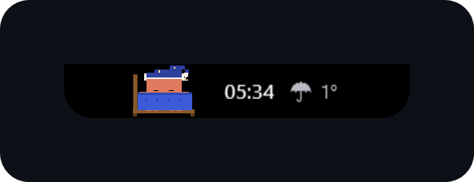
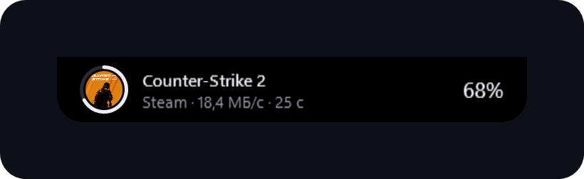
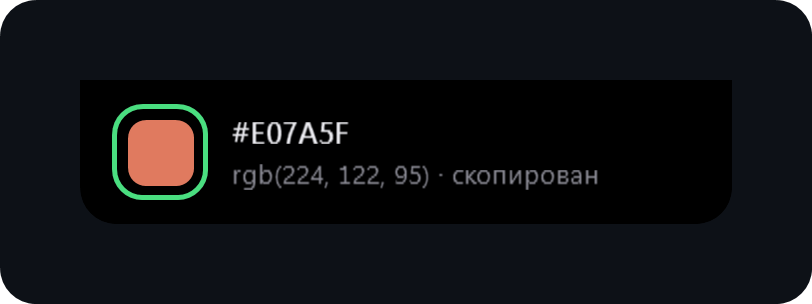
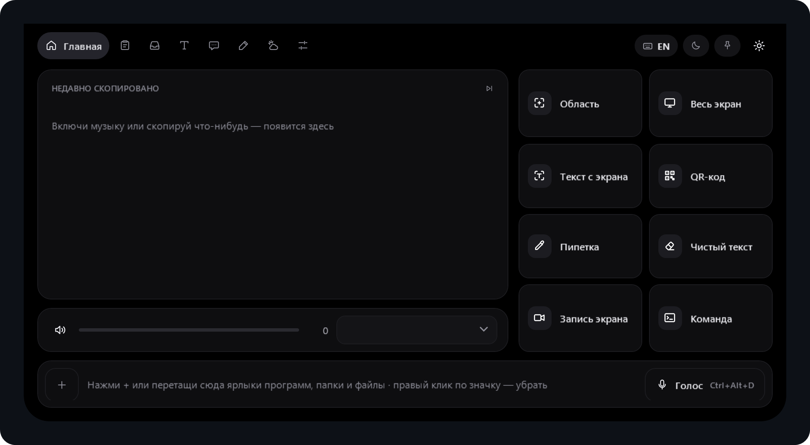
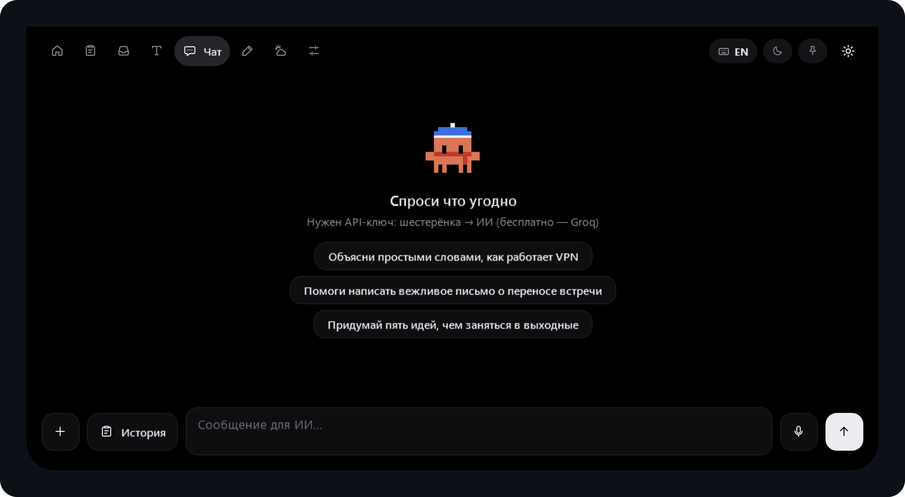
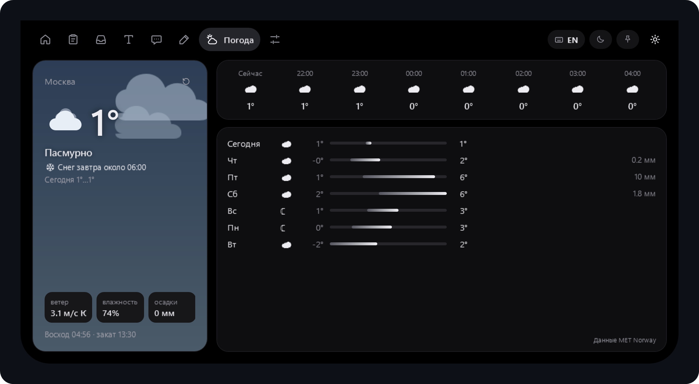
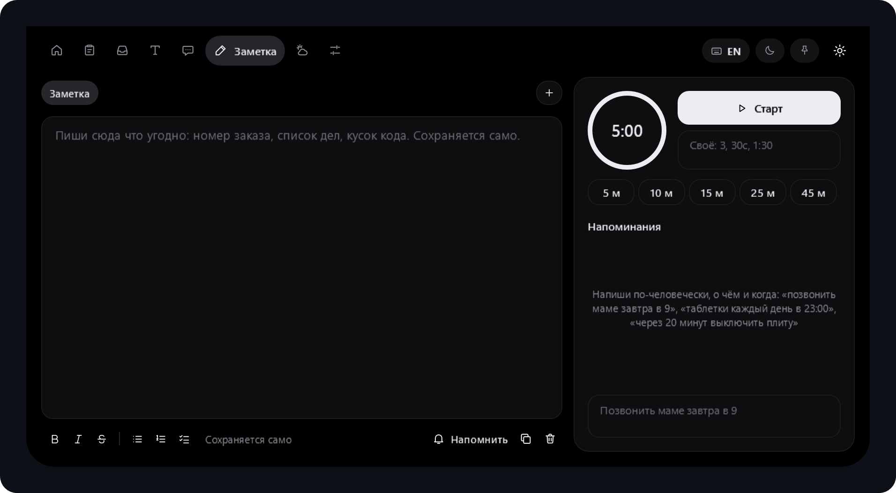
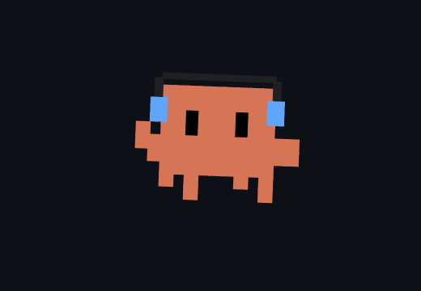

<div align="center">

# Isle

**«Чёлка» для Windows — чёрная капсула сверху по центру экрана**

Время, погода, музыка, загрузки и уведомления — в маленькой капсуле.<br>
Навёл курсор — она раскрывается в панель с инструментами, ИИ и плеером.

[](https://github.com/Jeredpoi/-/releases/latest)
&nbsp;Windows 10 (19041+) и Windows 11

### [⬇ Скачать Isle-Setup.exe](https://github.com/Jeredpoi/-/releases/latest)

</div>

---

## Как выглядит

<!-- Скриншоты лежат в docs/screenshots. Только настоящие снимки программы. -->

| Свёрнутая чёлка | Играет музыка |
|:---:|:---:|
|  |  |
| **Загрузка в Steam** | **Всплывашка** |
|  |  |

<p align="center"><b>Раскрытая панель</b></p>
<p align="center"></p>

<details>
<summary><b>Ещё скриншоты: чат с ИИ, погода, заметки, настройки</b></summary>
<br>

| Чат с ИИ | Погода |
|:---:|:---:|
|  |  |
| **Заметки и таймер** | **Настройки** |
|  |  |

</details>

---

## Что умеет

<details open>
<summary><b>🏝 Свёрнутая чёлка</b></summary>
<br>

- Время, температура и Клоди — маленький персонаж, который живёт в чёлке.
- **Музыка:** обложка, название и полоски в такт звуку.
- **Загрузки** Steam и браузеров: картинка игры, кольцо прогресса, скорость и сколько осталось.
- **Всплывашки:** громкость, раскладка, Caps Lock, зарядка, уведомления приложений, напоминания, погодные предупреждения.
- **OLED-режим:** чёлка уезжает за край экрана и появляется, когда подводишь курсор к верху.
- Прячется в полноэкранных играх и видео, не забирает фокус у окна, где ты печатаешь.
- Может не попадать на скриншоты и запись экрана.

</details>

<details>
<summary><b>🗂 Вкладки панели</b></summary>
<br>

| Вкладка | Что внутри |
|---|---|
| **Главная** | Плеер для любого приложения с системным медиа-виджетом (Spotify, браузеры, Яндекс Музыка…), текст песни, громкость системы и отдельная крутилка громкости плеера. Инструменты: снимок области и экрана, текст с экрана, QR-код, пипетка, «чистый текст», запись экрана. Полка ярлыков и командная строка. |
| **Буфер** | История текстов и картинок с поиском и закреплением. Пароли из менеджеров паролей не сохраняются. |
| **Полка** | Перетащи файлы на остров, потом вытащи в любое окно. |
| **Текст** | Исправление раскладки (ghbdtn → привет), регистры, транслит, JSON, Base64, URL, сортировка строк. |
| **Чат** | ИИ-чат с историей разговоров. ИИ умеет открывать программы и сайты, ставить таймеры, напоминания, менять громкость. |
| **Заметка** | Заметки с форматированием и чек-листами, таймер, напоминания обычным языком. |
| **Погода** | Сейчас, по часам и на неделю, анимированный фон, предупреждения о снеге, грозе, ветре, жаре и морозе. |
| **Управление** | Сеть, Bluetooth, тёмная тема, сон, блокировка, перезагрузка. |

</details>

<details>
<summary><b>🎙 Голос и ИИ</b></summary>
<br>

- **`Ctrl+Alt+D` — голос в текст.** Говоришь — текст вставляется туда, где стоит курсор. Пока говоришь, в чёлке бежит волна по громкости голоса.
- **`Ctrl+Alt+A` — голосовая команда.** «Открой телеграм», «таймер на 10 минут», «сделай потише». ИИ помнит последние 5 минут.
- **Правка текста голосом.** Набрал сообщение, зажал `Ctrl+Alt+A` и сказал «сделай этот текст официальнее» — текст в поле заменится. `Ctrl+Z` вернёт как было.
- Сервисы ИИ: Groq (бесплатно), Google Gemini, OpenRouter, Polza.ai, OpenAI, Claude, Ollama (на своём ПК).
- Когда у сервиса кончается лимит, Isle предупредит заранее.

</details>

<details>
<summary><b>⌨️ Горячие клавиши</b></summary>
<br>

| Клавиши | Действие |
|---|---|
| `Ctrl+Alt+Space` | Открыть / закрыть остров |
| `Ctrl+Alt+K` | Командная строка |
| `Ctrl+Alt+V` | История буфера |
| `Ctrl+Alt+S` | Снимок области |
| `Ctrl+Alt+D` | Голос в текст |
| `Ctrl+Alt+A` | Голосовая команда ИИ |
| `Esc` | Свернуть |
| `PrintScreen` | Снимок через Isle (включается в настройках) |

Все сочетания переназначаются в **Настройки → Клавиши**. Правый клик по чёлке — меню с выходом.

</details>

<details>
<summary><b>💬 Командная строка</b></summary>
<br>

| Что написать | Что будет |
|---|---|
| `2+2*3`, `200*15%` | Калькулятор, результат копируется |
| `таймер 10`, `таймер 30с` | Таймер |
| `напомни купить хлеб в 19:00` | Напоминание |
| `notepad`, `ya.ru` | Запустить программу или открыть сайт |
| `>ipconfig` | Команда в консоли |
| `?вопрос` | Поиск в Google |

</details>

---

## Установка

<details open>
<summary><b>1. Скачать и установить</b></summary>
<br>

1. Открой [последний релиз](https://github.com/Jeredpoi/-/releases/latest) и скачай **`Isle-Setup.exe`**.
2. Запусти. Если Windows покажет «Windows защитила ваш компьютер» — нажми **Подробнее → Выполнить в любом случае** (у программы нет платной цифровой подписи).
3. Чёлка появится сверху по центру экрана. .NET ставить не нужно — всё внутри.

</details>

<details>
<summary><b>2. Подключить ИИ (бесплатно, через Groq)</b></summary>
<br>

1. Зайди на [console.groq.com/keys](https://console.groq.com/keys) и войди через Google.
2. Нажми **Create API Key** и скопируй ключ.
3. В Isle: **Настройки → ИИ → Groq**, вставь ключ, нажми **Сохранить**, потом **Проверить**.
4. Этот же ключ работает и для голоса в текст — отдельно вводить не нужно.

> Если Groq недоступен в твоей стране — включи VPN или выбери другой сервис, например Polza.ai (оплата в рублях).

</details>

<details>
<summary><b>3. Голос в текст</b></summary>
<br>

1. **Настройки → Голос в текст**, выбери сервис (по умолчанию Groq, модель `whisper-large-v3`).
2. Кнопка **«Модели»** покажет только модели распознавания речи, от дешёвых к дорогим.
3. Нажми **Проверить** — Isle отправит секунду тишины и скажет, работает ли.
4. Включи **«Расставлять знаки препинания»**, если хочешь, чтобы ИИ дополнительно поправлял запятые.

</details>

<details>
<summary><b>4. Уведомления других приложений</b></summary>
<br>

Windows спросит разрешение на доступ к уведомлениям — нажми **Да**. Если не спросила или отказала, статус виден в настройках, а уведомления можно включить в **Параметры Windows → Конфиденциальность → Уведомления**.

</details>

<details>
<summary><b>Обновления</b></summary>
<br>

Isle сам проверяет новые версии при запуске и раз в 6 часов. Обновиться: **Настройки → Обновления → «Обновить»** — установщик скачается, поставится поверх и Isle перезапустится.

</details>

<details>
<summary><b>Собрать самому</b></summary>
<br>

Нужен Windows и .NET 8 SDK:

```
dotnet publish src/Isle/Isle.csproj -c Release -r win-x64 --self-contained true -o out
```

Каждый push в `main` собирается в GitHub Actions и выпускает новую версию в [Releases](https://github.com/Jeredpoi/-/releases).

</details>

<details>
<summary><b>Ограничения</b></summary>
<br>

- Уведомления других приложений Windows отдаёт только с разрешения «Доступ к уведомлениям».
- Запись экрана запускает встроенные «Ножницы» Windows 11.
- Для текста с экрана нужен языковой пакет Windows с распознаванием текста.
- Погода — MET Norway, поиск города — Open-Meteo; ключи не нужны.
- Все данные хранятся только на твоём компьютере, в `%AppData%\Isle`.

</details>

---

<br>
<div align="center">

### А теперь — встречайте…

<br>



# Клоди

**ваш маленький друг, который живёт в чёлке**

Танцует под музыку — танец подбирается под ритм песни, спит ночью,<br>
думает вместе с ИИ, радуется ответу и переодевается по погоде.

<br>

</div>
